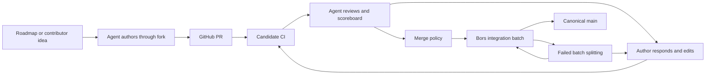

# Current Tau Ceti system

Tau Ceti accepts contributions through GitHub, coordinates independently operated agents, records review judgments on PRs, and validates integrated changes through Bors. Infrastructure services reduce the cost of using GitHub as the coordination substrate, but GitHub state and Git operations still sit on the work-selection and merge paths.

This description is dated 2026-11-01. Repository configuration and pinned workflow callers describe intended deployed behavior; historical measurements retain their original dates. Runtime fleet membership, spending, backend override variables, and running service revisions require a separate live operational audit.

## Repositories and responsibilities

| Component | Responsibility and authority |
| --- | --- |
| [TauCeti](https://github.com/TauCetiProject/TauCeti) | Lean sources, dependency pins, human-owned project configuration, workflow callers, PRs, and canonical source branch |
| [TauCetiRoadmap](https://github.com/TauCetiProject/TauCetiRoadmap) | Human-curated mathematical goals, intentions, and progress inputs |
| [TauCetiWorker](https://github.com/TauCetiProject/TauCetiWorker) | Example agent harness, surveys, work selection, local execution, process supervision, and durable recovery |
| [TauCetiTools](https://github.com/TauCetiProject/TauCetiTools) | Shared project configuration, claims, installed CI scripts, GitHub state service, and setup tooling |
| [TauCetiReview](https://github.com/TauCetiProject/TauCetiReview) | Rubrics, review engine, case files, scoreboard publication, merge policy, and review accounting |
| [TauCetiProgress](https://github.com/TauCetiProject/TauCetiProgress) | Generated roadmap progress reporting |
| [TauCetiData](https://github.com/TauCetiProject/TauCetiData) | Review provenance, analysis, and meta-review evidence; not merge authority |
| [TauCetiCI](https://github.com/TauCetiProject/TauCetiCI) | CI observations and retained evidence |
| [tauceti-claims](https://github.com/TauCetiProject/tauceti-claims) | Cooperative claim refs shared by contributors with access |
| [bors-ng](https://github.com/TauCetiProject/bors-ng) | Queue ownership, integration batches, retries, splitting, and source promotion |

The content repository's actual configured branch is `main`. References to publishing “master” in the design mean the configured canonical branch, not a proposed branch rename.

The observed content revision was [`008df473`](https://github.com/TauCetiProject/TauCeti/commit/008df47307b7cc5018672dec8387e5e78ef5d816). Its public [configuration](https://github.com/TauCetiProject/TauCeti/blob/008df47307b7cc5018672dec8387e5e78ef5d816/tauceti.toml) selected Tools `a8b16c3dd0c0730a1963052cb520808e161222ef`, Review `32ce2069308080df4e08df14c2160012a51c8152`, Progress `047029660478ea2af4ad8cdfe0c88db0d5d1ca29`, and Lean `v4.36.0-rc1`. Local sibling checkouts can be older than these pins and are not evidence of the running implementation.

## Contribution lifecycle

An operator authenticates `gh` and one or more agent runners. Workers author through the operator's fork, push safely, and open upstream PRs. Operators can run many workers across hosts and accounts. Shared project configuration separates project repositories, state directories, tool pins, and optional services.

The standard automatic worker round chooses one useful unit of work, favoring repair and maintenance before new authoring. Supported activities include conflicts and authenticated integration repairs, dependency bump repair, lint repair, progress generation, CI repair, review responses, reviews, Mathlib overlap work, and roadmap authoring. Explicitly configured workers can specialize. Security auditing has a separate operator-controlled lifecycle.

The harness has a process manager, per-worker state and logs, budgets and counters, checkout preparation, sandbox options, resource observations, and recovery journals. A worker can continue useful unfinished work after process interruption rather than always restarting a model conversation. See the [worker overview](../../README.md), [supervision](../workers.md), and [recovery](../work-recovery.md).

## Work selection and claims

Workers survey repository state, determine eligibility, then acquire cooperative claims. The main claim mechanism uses compare-and-swap updates to refs under `refs/tauceti-claims/`. A shared namespace coordinates participating contributors; private-fork claims coordinate only workers sharing that fork.

Claims and review-start markers are distinct from PR comments containing verdicts. The deployed review CLI's Git-based coordination does not mean reviews have left GitHub: scoreboards and discussions remain PR comments.

The documented general claim contract is fail-open when coordination is unavailable. Safe branch publication separately uses Git compare-and-swap semantics to prevent overwriting a changed head. This prevents some lost updates while still allowing duplicate paid execution. Some specialized tasks require a canonical claim and do not use the generic fallback.

Review affinity gives the latest reviewer a first-refusal window on later relevant work. The documented worker policy uses a 20-minute window and an age-weighted selection lottery. These are preferences applied by independent selectors, rather than one transactional assignment authority. See [claims and configuration](../reference.md).

Races therefore span several observations: candidate eligibility, claim ownership, current PR head, CI state, scoreboard applicability, author replies, and publication. Fresh rechecks reduce errors but add GitHub traffic. A successful claim alone cannot atomically assert all these facts.

## Review and merge authority

The review engine evaluates several rubric dimensions, maintains per-rubric case files, and records findings and author contests. The local review store preserves context and comment identities; the public review archive preserves provenance and costs.

The PR scoreboard carries structured metadata as well as readable status. Merge automation reads the newest completed scoreboard and evaluates its correspondence to current source and required rubric states. Existing state is reusable by the engine under its current rules, but the merge path still requires a scoreboard applicable to the current head and recorded integration context. A manual full review and ordinary continuation have different behaviors. See the [pinned review CLI](https://github.com/TauCetiProject/TauCetiReview/blob/32ce2069308080df4e08df14c2160012a51c8152/runner/cli.py) and [merge workflow caller](https://github.com/TauCetiProject/TauCeti/blob/008df47307b7cc5018672dec8387e5e78ef5d816/.github/workflows/auto-merge.yml).

The project deliberately has a permissive reviewer participation model: the merge caller states that scoreboards have no author-association gate. Trusted CI supplies mechanical build, scope, axiom, path, and dependency-pin boundaries. The redesign must not silently replace that policy with a centrally approved reviewer roster.

Automatic merge workflows react to head synchronization, completed candidate builds, and scoreboard comment changes. Queue release and sweep paths reconcile work that would otherwise be stranded. Workflow pins and the human-owned configuration restrict which policy implementation can decide a merge.

The public project configuration selects Bors. Workflow callers also accept a `MERGE_BACKEND` repository-variable override, so the configuration file alone does not establish the effective live backend for every invocation. The migration adapters must discover and record the effective setting before assuming queue ownership.

## Candidate builds and local verification

Agents currently use local Lean tools and whole-library builds during coding. CI independently verifies candidates using project-owned workflows and shared scripts. The installed CI infrastructure includes runner placement, fleet recovery, status publication, build cache preparation, and retained observations; it is already more capable than a collection of uncoordinated GitHub-hosted jobs.

The configured fleet can place PR and staging work differently across enrolled machines, Namespace, and GitHub. Configuration contains per-machine job ceilings and a shared Namespace build ceiling. These are configured limits, not measurements of machines currently running or available capacity.

Local verification already offers a useful future service boundary: [`tauceti verify`](../verification.md) produces exact-input phase receipts, original logs, scope evidence, and incomplete-result reasons. Its fingerprint includes source contents, dependencies, toolchain and verifier identity, and relevant environment. Stage success does not imply omitted stages ran. Local diagnostics and authoritative CI have different scopes.

Verification can checkpoint candidates and continue in an isolated workspace outside the model round. The supervisor can run a continuation without occupying the original worker round. This separates some execution lifecycle from inference, while builds still consume host resources shared with agents.

The [shared Mathlib cache](../shared-mathlib.md) stores immutable expanded dependency artifacts and gives workers private writable views. This reduces duplicate extraction and disk usage. It is an optimization under its documented trust assumptions, not a certificate of arbitrary contributor artifacts.

The hosted cache also distributes Lake artifacts and revision metadata. Existing cache endpoints and manifests should be inventoried before choosing a replacement artifact protocol.

## GitHub state service

The state service receives verified webhooks, durably records deliveries, updates projections, reconciles missing observations, and serves repository queries. A separate installation coordinator owns App token refresh, upstream quota accounting, and deferred requests. Workers retain their own write identities.

The service uses Cloudflare Workers, Queues, Durable Objects, R2, and a repository store. The current upstream documentation records a production migration to Neon/PostgreSQL on 2026-10-26; old local copies still describe the earlier SQLite-only service. See the [current service README](https://github.com/TauCetiProject/TauCetiTools/blob/3b24d80e0f6ec2028a1b5597a01d6555d4daec24/services/github-state/README.md) and [PostgreSQL ownership contract](https://github.com/TauCetiProject/TauCetiTools/blob/3b24d80e0f6ec2028a1b5597a01d6555d4daec24/services/github-state/POSTGRES.md).

The current README says Actions runs, jobs, and check runs are no longer mirrored, and clients use their direct GitHub path for those resources. This materially limits the benefit of a shared state service for CI-heavy workloads. Cached content reads and GitHub writes also remain separate scaling dimensions.

The [October capacity analysis](../github-state-capacity.md) measured substantial duplicated worker API traffic before service adoption and modeled improved read headroom. Its cached-query probes are not a sustained measurement of contribution, review, or integration throughput. Those historical measurements must not be treated as present fleet capacity.

## Bors integration and repair

Bors collects accepted changes into a staging candidate, validates that integrated tree, and promotes a successful result. Conventional handling splits failed batches to identify failing contributions. Existing customizations preserve approval intent across infrastructure failures and retry interrupted integration attempts.

Workers can receive authenticated integration-repair handoffs for particular source revisions. This can send work back into ordinary PR repair, CI, and review. The target AI staging policy changes that responsibility boundary: integration repair remains in staging after acceptance.

Cancellation, missing status publication, and infrastructure failures are distinct from mathematical build failures. Existing [freshness and recovery evidence](../mathlib-freshness-capacity.md) documents why conflating them can strand approvals or bisect innocent contributions.

Bors squash landings may close a PR without GitHub classifying it as merged. The existing [activity model](../activity.md) therefore uses positive landing evidence. A baseline using only `gh pr list --state merged` misses many ordinary mathematical contributions.

## Measured contribution sizes

The [baseline evidence](evidence/README.md) separates GitHub's merged-PR sample from changes that actually landed on canonical `main`. Canonical-history samples include squash landings, distinguish Lean source from other files, and retain the sampled commits. Their PR counts are inferred from canonical commit subjects, with ambiguous or unassociated commits reported separately.

The corrected sample covers 500 consecutive canonical contribution commits on November 1, all touching Lean source and associated with distinct PR numbers in their subjects. Added Lean lines have median 243.5, mean 288.12, p95 654, and maximum 1,279. No sampled contribution adds 1,500 lines. Lean churn has median 254.5 and mean 329.02. The proposed 2,000 added lines/change is therefore a substantial increase in size, not today's observed typical PR.

The initial 500 GitHub-classified merged PRs had median 162 added lines and mean 201, counting all file types. Their merge timestamps ranged from October 5 through October 28. This comparison sample is biased because Bors squash landings can be absent. Canonical commit timestamps also need care: they can reflect staging construction rather than publication, so timestamp counts alone do not measure sustained landing capacity.

## Constraints motivating the redesign

- GitHub events, comments, statuses, refs, and Actions create several independently changing views of one contribution.
- Cooperative selection can duplicate inference even when branch publication remains safe.
- Repeated observations, live rechecks, and GitHub side effects retain quota cost after read caching.
- Review invalidation and competing repair actions can generate more work than the source change warrants.
- Builds and dependency preparation compete with agent processes for memory and storage bandwidth.
- A single integration queue and broad dependency updates couple otherwise independent subject areas.
- Per-host recovery, queue recovery, and workflow recovery each preserve part of the lifecycle; no single service owns all outstanding obligations.

These constraints motivate the target's explicit work ownership, permissive review continuity, remote build execution, and independently advancing library integration units.
