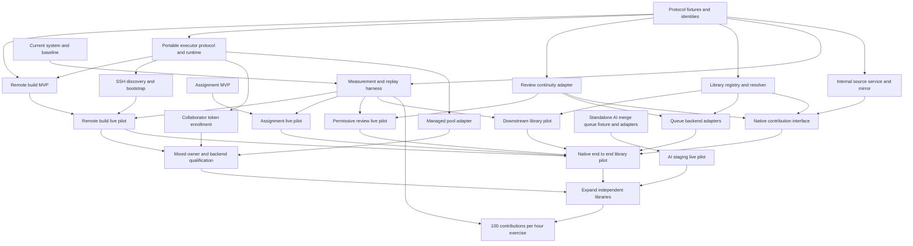

# Migration dependency graph

The redesign proceeds through independently useful services. A native contribution interface is not a prerequisite for remote builds, central assignment, permissive review continuity, or downstream library registration. Workstream dependencies are explicit below and in the [machine-readable graph](migration-dag.json).

The current priority is the [standalone AI merge queue](specs/ai-merge-queue.md). Its fixture and live-pilot work use existing GitHub admission, agent harnesses, and CI; they do not wait for the other overhaul services.

All deployments use live updates. Existing paid rounds and CI continue; no node requires draining the fleet or pausing normal admissions. Implementing a service does not authorize buying compute, adding paid workers, creating production repositories, or sending external messages.

## Hard prerequisites

The native pilot can use a conventional queue. It does not wait for AI staging to be production-ready. The standalone AI staging pilot uses existing GitHub intake, reviews, and CI. Completing either pilot does not require selecting one queue policy for every library.

## Work packages and completion evidence

| ID | Deliverable | Hard prerequisites | Completion evidence |
| --- | --- | --- | --- |
| E | Current-system map and baseline | None | Sources, observed configuration pins, actual canonical landing sample, size definitions, known sampling bias |
| P | Shared protocol fixtures | None | Snapshot/digest examples, identity and ownership contract, reference request/response fixtures |
| M | Measurement and replay harness | E, P | Joined job/attempt/change metrics, failure replay, data-size/resource report, no model calls required |
| FE | Portable executor protocol and runtime | P | Standalone agent, discovery/capability report, owner caps, identity/session reconciliation, private execution and result fixtures |
| FS | SSH discovery and bootstrap | FE | Hostname-only inventory, permission/runtime discovery, shared installer, idempotent deployment without preinstalled build tools |
| FT | Collaborator token enrollment | FE | One token/one command behind NAT; scoped redemption, renewable node credentials, owner limits, update/uninstall |
| FK | Managed pool adapter | FE | Existing Kubernetes namespace adapter, same request/result protocol, bounded capacity and restart reconciliation |
| B | Remote build MVP | P, FE | CLI, API, job store, portable execution, isolated warm inputs, receipt; build-spec acceptance scenarios on fixtures |
| A | Assignment MVP | None | Atomic claim, leases, retained results, observer and worker adapter, automatic outage fallback |
| R | Review continuity adapter | P | Existing approval import, carried effective state, scoped findings, compatible truthful scoreboard projection |
| L | Library registry and resolver | P | Core plus disposable downstreams, exact vectors, diamond/cycle tests, separate integration-unit mapping |
| BP | Remote build pilot | B, M, FS | Natural work on initial SSH-assembled capacity; latency/resources, useful completions, lost callback/executor recovery, bounded CI adoption |
| FC | Federated build cluster qualification | BP, FT, FK | One logical cluster combines SSH, token, and managed capacity from independent owners/networks with enforced caps and equivalent results |
| AP | Assignment pilot | A, M | Shadow comparison then selected owned keys; lower duplicate inference/GitHub selection reads; no lost legacy work |
| RP | Permissive review pilot | R, M | Ordinary edits retain approvals with zero mandatory reassessment calls; measured reuse and quality sampling |
| LP | Downstream library pilot | L, M | Chosen library boundary evidence, independent pinned builds, adoption coalescing, integration policy selected |
| Q | Queue backend adapters | L, R | Conventional adapter reconciles queue membership; common acceptance and publication contract; per-unit authority |
| S | Standalone AI merge queue fixture and adapters | None | Increment 0 risk reduction (shadow repair, attributed chain tool, readmission age, journal report, GitHub App), then scripted clean operations/CI, attributed commit series, AI conflict/CI repair, one open batch and one head, claims, runtime controls, and the inference-unavailable hold |
| G | Internal source and GitHub mirror | P | Immutable source submission, safe canonical ref promotion, offline dependency retrieval, outbox/recovery |
| U | Native contribution interface | R, G, L | Public changes/diffs, findings/replies, approvals, builds, attribution, export, contributor CLI/Git workflow |
| N | Native end-to-end pilot | BP, AP, RP, LP, U, Q | One library accepts/reviews/integrates internally; GitHub outage leaves it operational |
| SP | AI staging live pilot | S | Existing repository's accepted integration failures remain staging-owned; real assembly/CI/promotion and operator intervention work |
| X | Expand independent libraries | N, SP, FC | More than one queue progresses under mixed policies and owner-controlled capacity; dependency and shared-resource contention measured |
| T | Target throughput exercise | X, M | Measured sustained 100 contributions/hour with representative ~2,000-line size mix, costs, backlog, latency, and quality |

E's initial documentation and sample are included in this document set. P currently exists as a specification; executable interoperability fixtures remain an implementation deliverable for components adopting it. A and S define their necessary contracts locally and can start without P. No implementation or pilot is claimed complete by writing its specification.

## Startable engineering work

S and A can start from their self-contained specifications. Components adopting P can work independently after agreeing their needed boundary. P should contain only the common interfaces needed by those implementations; it must not become a months-long platform project. An implementation can propose a compatible amendment with fixtures while progressing its own component.

FE defines and qualifies the portable executor boundary for B. Once its interface is agreed, FS, FT, and FK proceed independently using the same discovery, installer, and execution payloads. Initial BP work can use SSH-assembled hosts while collaborator enrollment and the managed adapter are built. FC requires all three and is the completion condition for federated cluster assembly. A useful early build pilot does not need to wait for production Kubernetes onboarding.

Build work can initially use a static library/dependency manifest. Assignment can operate against existing local verification and existing PRs. Review continuity can use the existing store and GitHub scoreboard adapter. Registry can observe existing Bors without owning its mutations. These are supported pilots, not incomplete versions of the native website.

G and the Gerrit/native-interface evaluation can proceed while live service pilots collect evidence. B is greenfield; learn from Kiln's measured behavior and failure cases without requiring its implementation. Evaluate Lake cache reuse during B and Workflows/Temporal during concrete recovery work, without making selection of a universal orchestrator a hard prerequisite for every node.

## Authority and deployment boundaries

| Workstream | Activation unit | Existing behavior during pilot | Rollback |
| --- | --- | --- | --- |
| Remote builds | Worker/workload/candidate class | Other builds and all inference continue | Route new selected work to previous backend; retain remote receipts/subscriptions |
| Assignment | Work key and participating worker set | Other keys keep legacy selection | New epoch plus checkpoint/handoff; restore selector for selected keys |
| Review continuity | Change/library with one projection writer | Other PRs use current engine | Preserve carried projection until old consumer supports exported effective states |
| Registry/adoption | Library/dependency edge | Existing pins stay usable | Stop new adoption assignments; retain vectors and source |
| Queue ownership | Integration unit | Other queues continue independently | Transfer obligations and publication authority through new epoch |
| Native intake | Library or selected contribution set | Existing GitHub PRs continue under declared owner | Keep accepted native work owned; move only explicitly transferred intake |

An old publisher that cannot honor ownership must be excluded from the selected activation scope before the new path writes. A shadow observer does not need that exclusion because it cannot mutate. Mixed operation needs an ownership inventory, not two systems allowed to race and a hope that compare-and-swap will settle every semantic decision.

## Risk reduction experiments

1. Measure canonical landings, review calls, build CPU/memory, preparation bytes, and queue waits with stable correlation IDs. Separate the large-PR target from today's small-PR distribution.
2. Replay source updates during review and check that approvals remain effective unless an explicit action changes them. Count unnecessary model calls as a failure.
3. Kill a worker/executor after upload but before completion; verify useful evidence remains adoptable and mutable state has one owner.
4. Resolve a diamond with conflicting pins, then repair it through adoption without stopping unrelated queues.
5. Simulate repeated upstream publication while downstream candidates and adoptions run; check there is no cancellation storm.
6. Make GitHub unavailable after snapshot capture and verify internal builds and native integration continue. Track mirror lag independently.
7. Restore the database and referenced artifacts, then reconcile a pending Git ref update without repeated inference.
8. Exercise normal AI conflict/CI repair with intact sealed membership, then separately test inference-unavailable degradation: modified PRs return to authors with retained commit links and remaining approved work splits conventionally.

Use disposable fixtures and recorded events for fault and scale tests. Production pilots use naturally selected authorized work; extra paid load or capacity needs its own authorization.

## Throughput evidence and expansion

Before T, run synthetic control-plane replay at 10 times the target contribution arrival rate and the worker/build concurrency targets in the specs. This demonstrates scheduling and recovery headroom, not mathematical throughput.

For T, report a sustained six-hour window at 100 landed contributions/hour, plus 24-hour backlog and recovery observations. Publish actual per-contribution Lean additions/deletions, review quality samples, inference/build cost, attempts, repair fraction, and per-library distribution. A run dominated by present-day ~250-line changes does not demonstrate the ~2,000-line target. Generated/padded source is excluded by the same review quality policy used for normal work.

The six-hour target is an initial proposed acceptance exercise, not authorization to generate that workload or buy resources. Use the operator's funded production ramp. Report partial results honestly, including whether a backlog was consumed rather than a stable arrival rate maintained.

The separate “100 times” ambition needs a comparable dated baseline for both contributions/hour and useful source/API progress. The recent canonical sample is substantially smaller than 2,000 lines/change and covers a limited window. Keep absolute targets and measured improvement ratios separate.

## Decisions needed before the respective live pilots

- BP: executor machines/resources, trusted verification policy, interactive latency tolerance, cache provenance, and authorized remote-workload scope.
- FC: capacity owners/pools, allowed workloads, owner caps, installation permissions, and the managed namespace used for qualification. SSH access and donated-machine enrollment do not imply permission to administer unrelated workloads.
- AP/RP: activation keys, legacy publisher inventory, open participation configuration, and review-continuity schema support in the pinned consumer.
- LP: first real subject boundary, repository/ref mapping, package names, import roots, dependency freshness policy, and selected queue mode.
- SP: The first increment is one open batch and one sealed head in a separate Python queue service taking over opted-in repositories from Bors; successors, background CI, combination and cap pressure are later increments. Scripted clean operations/CI, per-PR commits, no eviction with shrink-to-green as the agent's only exit, no stacking on unlanded predecessors, age-windowed random insertion without agent assistance, provenance-flagged comments, worker-only agent execution with warm artifacts, hold-and-retry on inference unavailability, verdicts bound to a candidate's own completed run, membership other automation cannot withdraw, an operator urgent lane, dedicated staging capacity with recorded placement and progress, and the service's own GitHub App identity are decided; there is no exceptional-withdrawal process, and problems discovered after staging admission are addressed in follow-up PRs to Tau Ceti. Increment 0 (shadow repair, attributed chain tool, readmission age, journal report, GitHub App, dedicated runners) precedes the controller.
- N: native identity/onboarding, public retention/export, Git/source hosting, and ownership transfer for selected intake.
- T: funded capacity, representative workload, quality sampling, duration, and acceptable backlog/cost.

These decisions are attached to the nodes that need them. They do not block independent fixture implementation or earlier deployable work.
