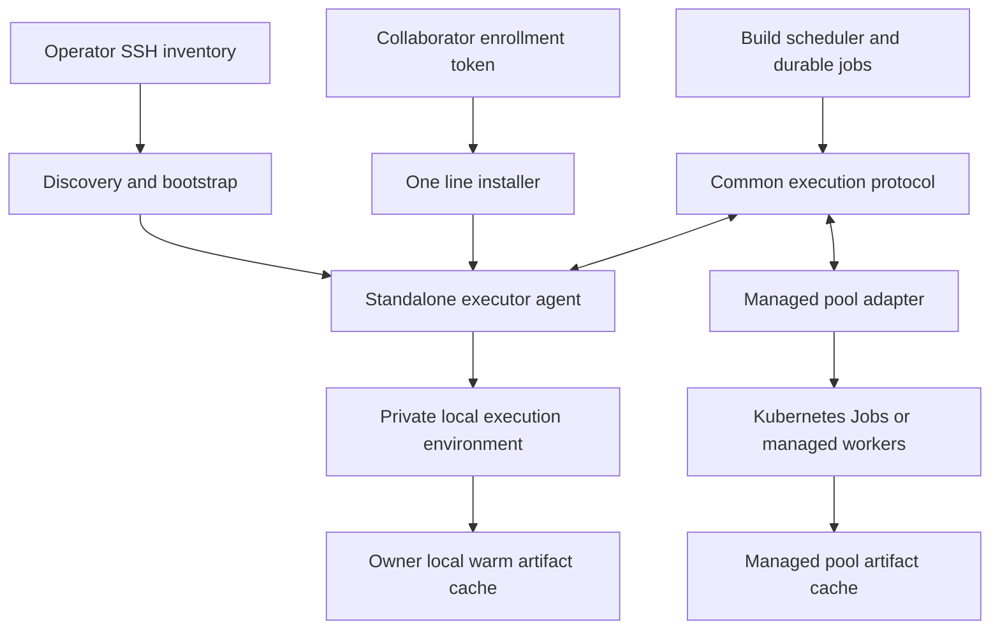

# Federated build cluster specification

Implement a greenfield Lean execution fleet that combines machines owned by different people. A logical build cluster must accept capacity through SSH bootstrap, collaborator self-enrollment, and managed infrastructure such as Kubernetes. All three are required product interfaces; none may require the other two to adopt its infrastructure.

This specification extends the [build service](lean-build-service.md) and [shared protocol](shared-protocol.md). Kiln supplies useful lessons about diagnostics, preparation, caching, and recovery; its implementation, deployment, and operator workflow are not prerequisites.

## Cluster and execution model

A `cluster_id` identifies one scheduling and authorization domain. An `owner_id` identifies a capacity contributor. A `pool_id` groups capacity supplied through one administrative backend or resource policy. An `executor_id` identifies a registered execution endpoint; a physical host has a separate stable host identity and a fresh `boot_id` on restart. A pool may expose individual hosts or managed allocation slots, but must report which execution environment actually ran an attempt.



The scheduler assigns useful work and reserves an advertised resource budget. A local agent or managed pool owns execution placement and enforces that reservation. Snapshot, target, result, cancellation, and evidence semantics remain identical across backends. A client does not select a backend by changing the meaning of its build request.

Machines need no shared filesystem, public inbound address, common LAN, or common Kubernetes cluster. The standard execution transport uses outbound authenticated HTTPS on port 443 for claims, heartbeats, events, and scoped object transfers. Optional LAN/peer optimizations cannot be required for correct execution. Artifact and source payloads can travel directly to scoped object-store endpoints rather than through a central scheduler's filesystem.

An owner retains control of the donated machine. The local executor enforces owner caps even if the coordinator requests more. Cluster-level scheduling and owner-level resource limits are separate. A host contributing to multiple logical clusters must share one local resource arbiter so their advertised capacities are not independently spent twice.

## Common standalone executor

Distribute a signed, versioned standalone executable that does not require Python, Go, Docker, Kubernetes, or a Lean installation already on the host. A Go implementation is the initial proposal; build clients and the existing Python harness can use separate adapters. Release manifests select the binary for detected OS/architecture and bind its digest and protocol versions.

The executor reports CPU architecture/features, OS/kernel, effective resource limits, scratch/cache filesystems and free space, available isolation mechanisms, outbound connectivity, local toolchains/artifacts, measured throughput, and owner constraints. Probe effective container/cgroup limits as well as physical resources; a virtual machine or container must not advertise its parent host's full capacity.

Initially support Linux x86-64 and arm64 execution. SSH discovery must recognize other or unrecognized platforms and report their status without assuming they are Linux. Add other executors through explicit platform adapters. Access to an arbitrary SSH server cannot guarantee the permissions/kernel facilities needed to isolate hostile Lean code; the product discovers and provisions what it can and reports the precise remaining capability when it cannot.

Keep supervisor credentials, host-management state, and the installation updater outside candidate workspaces. Toolchains and execution root filesystems are pinned downloads. Candidate builds get private writable inputs/outputs over immutable warm artifacts, with CPU, memory, process, time, and scratch limits.

Isolation is an advertised execution capability, distinct from machine ownership or enrollment method. Use qualified namespace/container isolation or VM isolation according to project policy and available host facilities. SSH itself provides transport, not candidate isolation. A generic container or Kubernetes namespace must not be represented as a complete hostile-code boundary without its configured restrictions. Candidates must not inherit the owner's home directory, SSH agent, container-management socket, executor credentials, or cloud/cluster administration access. [Bubblewrap's isolation model](https://github.com/containers/bubblewrap), [Kubernetes multi-tenancy](https://kubernetes.io/docs/concepts/security/multi-tenancy/), [Firecracker](https://firecracker-microvm.github.io/)

Prefer unprivileged installation and execution where the host supports it. A privileged host helper is an explicit install option with a narrow interface, not arbitrary root shell access exposed to build requests. Discovery may identify or provision required helpers under the installation permissions already granted. An unsupported machine remains visible as not currently eligible for the affected workloads; it does not prevent the rest of the fleet from operating.

## SSH inventory bootstrap

The operator supplies a plain list of SSH destinations, optionally enriched with owner/resource metadata. Honor the operator's SSH configuration, keys, host-key verification, ports, and jump hosts. SSH credentials remain on the operator's management machine and are never uploaded to the build coordinator or sent to candidates.

Proposed commands:

```text
tauceti build cluster bootstrap --cluster main --hosts hosts.txt
tauceti build cluster inspect --cluster main
```

Bootstrap must:

1. Connect and discover the remote platform, architecture, permissions, filesystem, existing service facilities, and execution capabilities. Do not require Bash, Python, Docker, systemd, root, sudo, or a particular package manager as prerequisites. Use the remote command environment's platform adapter; unsupported command environments receive a precise discovery result.
2. Choose an applicable signed executor release and install it into an owned prefix. Provision required dependencies or a private execution image through a supported adapter when permissions permit. Use a dedicated prefix and state directory; do not modify existing Lean installations or system-wide `PATH`.
3. Generate a node key on the remote machine, enroll it into the requested owner/pool/cluster scope, and persist protected credentials locally.
4. Install a persistent service through the available facility, or run a supervised SSH-session worker when no persistent service is available. Report which lifecycle is in use. Reboot persistence is a capability, not an assumption.
5. Exercise a small owned execution fixture and report the effective resource and isolation profile. A node becomes eligible immediately after its configured checks pass, without a separate manual approval per build.

Discovery is read-only. The bootstrap command authorizes installation under the named policy; provide `--plan` to show changes without applying them. Use noninteractive privilege checks; missing permissions become reported actions rather than password prompts hanging a fleet operation. Re-running bootstrap reconciles the same installation and node identity instead of registering duplicates or starting another executor.

A lost SSH connection does not cancel builds already owned by a persistent executor. An SSH-session executor records its less durable lifecycle; lost-session work follows the same lease/checkpoint recovery as any disappearing machine. If the node cannot reach the coordinator directly, an optional operator-side tunnel/relay can carry the same protocol with explicit dependency on that relay's uptime. Do not require a relay for ordinary outbound-capable nodes.

## Collaborator token and one line installation

An operator creates a short-lived enrollment token bound to cluster, owner/pool, allowed workloads, and maximum contributed resources. The collaborator receives that token and one command. The installer performs the same discovery, provisioning, enrollment, and qualification used by SSH bootstrap; there must not be a second hand-maintained installation recipe.

Illustrative proposed command, using a placeholder domain:

```sh
curl -fsSL https://build.example.org/install.sh | sh -s -- --cluster main --token '<one-use enrollment token>'
```

The command is a product interface to implement, not an existing endpoint. The installer chooses a signed pinned agent release and prints its installation prefix, owner, cluster, effective caps, running mode, status command, and uninstall command. The fetched installer is itself part of the trusted distribution path; checking a downloaded binary does not remove that trust requirement. Provide a downloadable installer/binary path for owners who want to inspect or distribute it themselves.

The default shared-host profile contributes at most half of effective CPU and one quarter of effective RAM, caps retained cache at 50 GiB, and preserves at least 10 GiB free disk. Support fractional CPU quotas or report that the remaining budget cannot fit the requested execution class; do not round above the owner's cap. Publish actual resulting quantities. A host with less than the required scratch/reserve capacity waits visibly rather than filling its disk. `--dedicated` and explicit `--cpus`, `--memory`, `--cache-size`, and `--disk-reserve` configure a different owner-approved budget. These are initial proposed defaults, not a universal sizing claim.

No inbound port, SSH account, static IP, VPN enrollment, or membership of a shared Kubernetes cluster is required. The owner may install in user mode on a shared workstation or choose system-service mode for a dedicated server. Missing privileges must not silently trigger a privileged install or weaken the selected isolation policy.

Enrollment tokens default to one redemption and a 30-minute lifetime. A retry using the same token and the same generated node key returns the original enrollment after a lost response; another node key cannot redeem it again. Never ship permanent cluster credentials inside a public installer or print tokens in ordinary logs. The inline token is transient and becomes useless after redemption/expiry; protect it before use, and offer token-file input for noninteractive secret management.

After redemption, use a distinct node identity and short-lived renewable credentials. Revoking an enrollment token prevents unused enrollment; it does not revoke an already issued node identity. Node revocation is a separate action. Enrollment authorizes only the workloads/cache trust policy selected by the issuer; it cannot elevate the node to cluster administrator or expand its owner's caps.

## Managed infrastructure adapter

Expose managed capacity as a pool implementing the same claim, execution, events, result, and cleanup protocol. The first managed adapter targets an existing Kubernetes cluster. A logical build cluster can include several independently administered Kubernetes clusters plus direct machines; there is no requirement to join their networks or control planes.

Ship a versioned namespace-scoped installation bundle or chart with a pool adapter, narrowly scoped RBAC, execution templates, cache/storage configuration, egress policy, and owner limits. The cluster owner installs it using their own credentials. Neither candidate Pods nor the global build scheduler require that owner's general kubeconfig.

The managed pool can use disposable Jobs with retained caches or registered persistent workers. The first adapter uses Jobs running the same execution payload/result collector as direct machines. A pool adapter claims an attempt under a bounded local capacity reservation, creates a deterministically identified Job, and persists its UID/attempt mapping. It records the actual placement/runtime identity in the receipt.

The global scheduler selects a workload, pool/resource class, and priority; Kubernetes chooses an eligible node inside that pool. Pool limits and pending placements remain visible. Do not advertise the same capacity again through both a pool adapter and direct executor registrations. A managed gateway's registration must not imply that it supplies all of its cluster's resources.

Job retries/restarts can execute code more than once, so the adapter retains the shared protocol's attempt/generation fences and idempotent result publication. On adapter restart, rediscover existing Jobs before creating replacements. A pool-side lost create response is resolved by identity lookup, not a fresh unrelated Job. [Kubernetes Job semantics](https://kubernetes.io/docs/concepts/workloads/controllers/job/)

Creating or resizing cloud machines is a separate optional provisioning adapter. Registering an existing managed pool does not authorize purchases, new accounts, or changes to unrelated workloads. Kubernetes is one capacity provider; build semantics and the public client API must remain usable without it.

## Enrollment and node API

| Endpoint | Contract |
| --- | --- |
| `POST /v1/clusters` | Create a logical cluster and owner policy; operator scope |
| `POST /v1/clusters/{id}/enrollment-tokens` | Issue scoped, expiring enrollment capability; record issuer and allowed resource/workload policy |
| `POST /v1/enrollments/redeem` | Present token, generated node public key, stable enrollment request ID, discovery report, and requested caps; return durable identity and scoped credential |
| `POST /v1/executors/{id}/sessions` | Start/reconnect authenticated boot/session identity; reconcile live attempts before new admission |
| `POST /v1/executors/{id}/heartbeat` | Renew presence and report owner caps, free resources, active reservations, and health |
| `POST /v1/executors/{id}/credentials/renew` | Renew scoped credentials using node identity proof |
| `PATCH /v1/executors/{id}` | Versioned owner policy, workload eligibility, and stop-new-assignment setting |
| `POST /v1/executors/{id}/revoke` | Stop new claims and define treatment of active work; preserve evidence |
| `POST /v1/pools` | Register a managed capacity source with its own owner caps and adapter identity |
| `GET /v1/clusters/{id}/capacity` | Per-owner/pool/platform usable, reserved, running, exporting, unavailable, and waiting capacity |

Use shared command idempotency and version behavior. Tokens/credential hashes and node public keys are stored server-side; node private keys stay outside candidates on the owner machine. A copied executor installation must not silently run the same identity on two hosts; boot/session reconciliation detects conflicting sessions and requires re-enrollment or an explicit replacement.

Build attempt claim/heartbeat/result endpoints remain defined by the build service. Capacity presence and attempt execution are distinct leases. Stale presence prevents new placement. A machine that reconnects first reconciles its actual child processes and reservations so it cannot start new work on capacity still occupied by an earlier attempt.

## Resources, failure recovery, and owner control

Each pool exposes owner-authorized maximums and observed usable capacity. The coordinator reserves within both; the local arbiter performs final admission using current memory, scratch, and other host load. A local capacity rejection releases/requeues the placement without repeating model work or invalidating completed outputs. Owner caps can be lowered live for new work without pausing other owners or the whole fleet.

OOM is an execution-resource outcome. Preserve completed valid outputs and retry on a larger allowed resource class or another eligible pool. Bound repeated identical OOM attempts. Disk pressure first reclaims unpinned disposable cache entries, then stops new placement on that executor if needed. Never delete active source snapshots, another user's files, or accepted outputs to make space.

Report compiler CPU/memory, preparation, artifact export, and cleanup separately. A completed compiler should release its compute allocation when the runtime can safely detach the remaining bounded export work; storage/transfer reservations remain until cleanup. A backend that currently holds the whole reservation reports that fact honestly. It must not free resources on paper while an orphan process still occupies them.

The owner can set schedules, lower caps, stop new work, or uninstall. Graceful withdrawal defaults to finishing current attempts and uploading evidence, then removing the owned service and credentials. Immediate withdrawal may interrupt attempts; classify them as interrupted infrastructure work and recover elsewhere. Neither mode changes global fleet admissions. Revoke credentials without erasing historical results or quietly abandoning accepted staging obligations.

Network partitions, changing IP addresses, suspended laptops, node reboots, and pool outages are normal. Local journals preserve attempt IDs, boot/process identity, checkpoints, and upload receipts. Use bounded retries/backoff and reconnect to reconcile authority before mutable completion. A late valid result remains adoptable evidence. No peer can force another owner's machine to stay online.

Machine owners in the initial deployment are trusted participants. Workload eligibility and artifact-sharing policy are separate from enrollment: a diagnostic-only pool cannot populate an authoritative CI cache unless policy permits it. Do not require every donated host to be centrally administered before it is useful. Host owners can inspect data on their machines, so private projects must route only to owners authorized to see their source.

## Scheduling across networks and platforms

Placement considers resource fit, observed compiler speed, warm dependency/output coverage, transfer bandwidth/latency, owner availability, and job priority. A remote machine with many nominal cores can be slower than a nearby warm node for a small edit. Prefer predicted completion time and retain fairness across owners/libraries.

Scope native artifacts by actual toolchain, relevant platform/ABI, configuration, and trust policy. Reuse only compatible output facets across x86-64/arm64 and other environments. Shared source blobs can be portable even when particular compiled/native outputs are not. Verification records identify what ran and where without making SSH, token, or Kubernetes membership a correctness criterion.

The protocol must leave room for distributing one large build across pools. Initial whole-Lake requests need not be split automatically across machines. Later compilation-action scheduling uses the same identities, resource caps, immutable artifacts, and attempt semantics rather than requiring a new cluster assembly mechanism.

## Updates and reporting

Executor updates use signed pinned releases, atomic installation, protocol compatibility checks, and a local rollback path. Keep running builds and their pinned execution environment intact across supervisor updates. Support mixed adjacent agent protocol versions during live rollout. Updating a direct executor must not require a reboot, replacing another owner's cluster, or installing Kubernetes.

Report owner/pool/node identity, installation method, runtime/isolation capability, protocol/release version, effective caps, available disk/memory, active work, cache coverage, recent useful completions, OOMs, connection age, and reasons for ineligibility. Machine names and owner details are private to authorized operators unless deliberately published.

## Deliverables and acceptance

Deliver the standalone executor and release manifest, shared discovery/installer library, SSH inventory client, token issuance/redemption service, collaborator installer, Kubernetes pool adapter/install bundle, capacity accounting, local journals, owner status/uninstall tools, and onboarding/update/recovery documentation.

Separate engineering packages implement the portable executor contract, SSH assembly, token enrollment, and managed adapter. Their fixture checks can proceed independently after the contract is agreed. All three assembly modes must pass before the federated build-cluster feature is declared complete.

Acceptance must show:

1. A hostname-only SSH inventory bootstraps supported minimal Linux hosts with no Python, Go, Docker, Lean, or Kubernetes installation. Missing root/systemd and an unsupported platform receive distinct useful outcomes; repeated bootstrap is idempotent.
2. A collaborator uses one token and one command behind NAT, without inbound connectivity or sharing SSH/cloud credentials, and completes a real Lean fixture within the published owner caps.
3. Expiry, wrong-cluster use, second-key token reuse, lost redemption response, credential rotation, and node revocation preserve the intended enrollment identity and scope.
4. A managed pool submits the same snapshot/targets, returns equivalent results, and recovers from a lost Job-create response and adapter restart without duplicate authoritative completion.
5. One logical cluster simultaneously uses SSH-enrolled, token-enrolled, and managed capacity owned by at least two independent parties and spanning two isolated networks.
6. Local and global accounting prevent owner-cap violations and double advertisement, including a host contributing to two logical clusters.
7. Candidate code cannot read executor credentials, other users' files, another attempt's writable outputs, or administrative sockets.
8. OOM, disk pressure, network loss, reboot, laptop suspension, and managed-pool outage recover useful work while other pools continue.
9. An owner lowers caps, withdraws, or updates their executor without pausing fleet-wide admissions or losing already retained results.
10. Platform-dependent artifacts do not cross incompatible execution profiles, while compatible sources/dependencies remain reusable.

Tests use disposable hosts, local VMs/network fixtures, and a disposable managed namespace. Live onboarding applies only to owners/machines supplied for that deployment; the specification does not perform installations or provision capacity.
