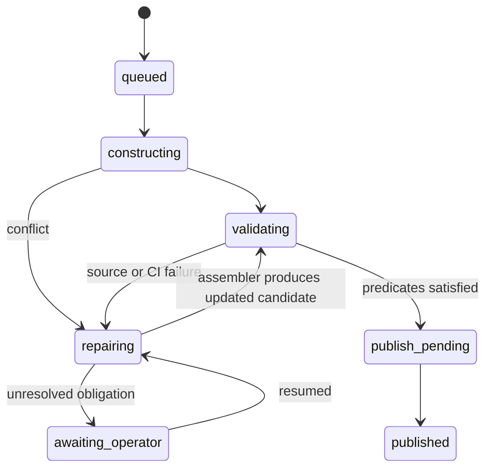

# Library integration service specification

Implement a registry and queue adapter that let core and subject libraries advance independently on reproducible dependency snapshots. The first deployment registers the existing core and a disposable downstream fixture, observes current integration, and schedules dependency adoption. Native Git hosting and AI staging can be added later through the same contract.

The service follows the [shared protocol](shared-protocol.md). It must support both conventional batch/split queues and AI staging repair queues without forcing every library to use the same policy.

The [AI merge queue implementation plan](ai-merge-queue.md) defines the standalone staging-repair workflow. That implementation uses the existing repository and CI and can proceed before this registry/service. The descriptions below explain how libraries select and expose its queue policy; they do not add prerequisites to the standalone task. Production choices left open in that plan are not settled by illustrative defaults here.

## Registry and integration units

Each library has a stable identity, Lake package name, namespace/import roots, source location, canonical ref, owner policy, dependency requirements, and integration-unit ID. An integration unit has one canonical publication boundary, queue backend/version, resource policy, and authority epoch.

Example proposed configuration:

```toml
schema_version = 1

[[libraries]]
id = "core"
package = "tauceti"
integration_unit = "core"
source_repository = "TauCetiProject/TauCeti"
canonical_ref = "refs/heads/main"
queue_policy = "ai_staging"

[[libraries]]
id = "subject-a"
package = "tauceti_subject_a"
integration_unit = "subject-a"
source_repository = "ExampleOrg/SubjectA"
canonical_ref = "refs/heads/main"
queue_policy = "conventional"
dependencies = ["core"]
dependency_update_policy = "coalesced"
```

The subject name and repository are fixtures. Selecting the actual first subject library is a separate mathematical boundary decision. Configuration is human-owned; changes to queue authority and dependency ownership cannot be made by ordinary source candidates changing their own configuration.

The registry accepts multiple libraries in one repository only when their declared integration units/ref boundaries are consistent. Libraries sharing the same canonical ref cannot promise fully independent source promotion. A combined unit is allowed and explicit; separate repositories are the initial recommendation for subject independence.

## Dependency resolution

Resolve declared requirements to an immutable complete vector of package identities, exact source revisions/snapshots, toolchain identities, and dependency edges. Follow the actual pinned manifests at each chosen revision. Distinguish the desired latest dependency from the currently adopted dependency.

V1 resolution begins from explicit pins; it does not invent a semantic-version solver. Return either a complete snapshot or a conflict showing incompatible requirements and graph paths. An agent can propose an adaptation or joint release to reconcile it.

For a diamond, both paths to core/Mathlib must resolve to the same package revision in the effective build. If they do not, return `422 dependency_conflict` with both paths. The resolver must not silently override an intermediate package's exact pin. A validated dependency-adoption revision can update those pins and produce a compatible graph.

Reject cycles in the actual resolved package graph. Where mathematical development suggests mutual dependencies, report the strongly connected group and proposed upstream factoring/combined integration boundary. The service must not claim that separate queues make mutually importing Lean packages buildable.

Toolchain compatibility is part of resolution. A library depending on a package compiled with an incompatible Lean distribution requires source rebuild/adoption under a compatible vector, not artifact relabeling. Third-party dependencies use the same source identity rules as registered libraries.

## API

| Endpoint | Command and result |
| --- | --- |
| `POST /v1/libraries` | Register library and unit mapping; operator scope |
| `PATCH /v1/libraries/{id}` | Versioned configuration update with `If-Match` |
| `POST /v1/dependency-snapshots/resolve` | Exact root requirements → immutable snapshot or conflict |
| `GET /v1/libraries/{id}/dependencies` | Adopted vector, desired updates, pending adoption work |
| `POST /v1/dependency-adoptions` | Create/coalesce an adoption obligation for a library and desired vector |
| `POST /v1/integration-units/{id}/acceptances` | Record accepted change, its reviews, source, dependencies, and chosen queue policy |
| `GET /v1/integration-units/{id}/queue` | Explain ordered obligations, cohorts, waiting conditions, and owner |
| `POST /v1/cohorts/{id}/revisions` | Append integrated source plus lineage and repair evidence |
| `POST /v1/cohorts/{id}/promote` | Validate configured predicates and enqueue expected-parent publication |
| `POST /v1/releases` | Record a validated coherent multi-library vector |
| `POST /v1/releases/{id}/activate` | Atomically advance an ecosystem channel's manifest pointer |

Snapshot, review, and build APIs are defined by their component specs. Integration reads them by immutable reference; it must not trigger full review as a side effect of reading a queue.

## Dependency adoption and compatibility jobs

An upstream publication updates an observable desired head and coalesces an adoption obligation per downstream library. New upstream events update the desired target without cancelling an active adoption attempt or changing its chosen vector. Default adoption policy chooses one vector when an attempt starts and lets it finish. An agent can explicitly retarget when the newer target is likely to preserve work.

Adoption work prepares new pins, performs source repair, obtains the relevant build results, and lets agents judge review continuity. Prior unrelated approvals remain effective. Adoption enters that downstream library's own queue and selected integration policy. Libraries not adopting continue to merge against their existing compatible vector.

Compatibility probes are separate from adoption. Probe direct dependents on proposed upstream candidates when useful, and run sampled/transitive checks according to risk and budget. A failed probe creates concrete adaptation work. The default upstream merge does not wait for all transitive probes. A library can opt into specific consumer checks as its own declared policy; there is no hidden ecosystem-wide gate.

Track dependency age and coalesced update lag. A freshness target creates prioritized obligations and alerts, not recurring wholesale cancellation of unrelated contribution work. An operator may prioritize a particular dependency update without pausing all admissions.

## Queue backend contract

Define an internal adapter interface with operations `inspect`, `enqueue`, `observe`, `retry_infrastructure`, `cancel`, and `reconcile`. Each operation accepts unit ID, policy version, authority epoch, and immutable input/output references. Adapters return typed states and external IDs; they cannot override review continuity or another unit's authority.

`conventional` may use existing Bors initially. Record external queue memberships and approved heads. Infrastructure retry differs from a demonstrated source failure. Splitting behavior is permitted only for cohorts recorded with this policy. Preserve bundle/stack semantics where the existing queue uses them.

`ai_staging` uses the standalone queue's scripted clean operations/CI and AI conflict/CI repair. Maintain independently based batch branches with a sealed prefix and capped unsealed suffix, and exactly one attributed squash commit per PR. There is no per-batch PR-count cap or separate staging review. When no inference path is available the queue holds with membership intact and resumes automatically.

Randomize insertion into available unsealed batches. Combine unsealed batches programmatically and cleanly only under cap pressure. Unsealed batches run no CI; runtime configuration controls batch caps, sealed-successor CI/repair, and its CI-backlog gate without a code PR. Proactively rebase sealed successors while preserving active work. Initially cap unsealed batches at 4 and target two sealed batches, sealing immediately when wanted and available. The runtime backlog threshold is initially 100 queued jobs sharing staging runners; stale/unavailable observations count as zero backlog. Under the standalone policy, cap pressure can exceed the target through clearly logged/counted operations. Membership is not evicted during normal operation. Once admitted to AI staging, a contribution lands through the AI's best-effort integration; authors/reviewers address later findings in follow-up PRs to Tau Ceti, with no exceptional-withdrawal process. Conventional queues retain their own formation policy.

Scripts and agents borrow batches before mutation and adopt private results against the expected version/claim. Agents append concise reasons only in affected commit messages. The controller validates membership bijection without positional comparison. Other batches and ordinary workers continue independently.

## State transitions

Conventional cohorts follow `queued → constructing → validating → publish_pending → published`, with explicit retry, split, and returned-for-repair transitions available under that policy.

AI cohorts follow:



Infrastructure interruption preserves source, membership, and useful attempts. Repeated source repair alone does not trigger splitting. Confirmed inference unavailability and a worker-wait timeout can invoke the standalone plan's explicit fallback, recording every returned or repartitioned member. Restore AI repair as soon as inference returns, preserving already-committed member dispositions. Runtime changes or retries do not erase that accounting.

Promotion checks that the assembler's current candidate has the required CI results for its actual source/dependency inputs and the expected canonical parent. Acceptance retains the original contribution approvals; there is no additional staging-review predicate. The publisher records intent, updates Git with compare-and-swap, and reconciles bookkeeping or mirror failures from actual ref/ancestry without repeating assembly or builds.

## Joint releases

A joint release records source revisions for only the involved libraries, their coherent dependency vector, build receipts, and agent judgments. Prepare immutable source objects before activating the ecosystem-manifest pointer. Readers choosing that channel resolve the complete vector atomically.

This does not make all individual Git refs update atomically. Publish component refs and GitHub mirrors with reconciliation, and expose their lag separately. Consumers requiring the atomic release view must use the manifest. Ordinary users of one subject library can keep using its canonical pinned build without waiting for a global manifest update.

Joint releases should be exceptional. Monitor their frequency and how many unrelated queues they hold. Frequent coordination across the same group is evidence to revisit library boundaries or shared APIs.

## Contention and capacity

Queue state, expected-parent publication, job reservations, and dependency adoption lock only the relevant unit or obligation. Global metadata updates must not acquire all library locks. Shared build/inference capacity uses weighted fair shares, priority floors, and borrowing, with per-library waiting reasons visible.

Measure per-unit accepted/landed rates, cohort size/duration, repair time, split count for conventional cohorts, unresolved AI obligations, core-edit frequency, cross-library joint-release count, dependency lag, and shared-resource waiting. Aggregate reporting counts each logical contribution once, regardless of repair commits or mirror pushes.

Initial benchmark uses at least five independent units with mixed policies, two dependency diamonds, and shared executor capacity. Run synthetic state/event replay at ten times the target contribution arrival rate without model calls. Verify one blocked unit does not block independent units and that adopted dependency vectors remain stable while desired heads advance.

## Deliverables and first deployment

Deliver registry/config schema, resolver, immutable dependency manifests, adoption-job generator, queue adapter interface, conventional observer/adapter, AI staging state-machine implementation for fixtures, publication reconciler, and release-manifest format. The first production increment may activate only registry/resolution and observation; document which mutation capabilities remain disabled.

Acceptance scenarios:

1. Core and two downstream libraries merge concurrently on their own pinned vectors.
2. Repeated core publications coalesce desired adoption work without restarting downstream attempts or invalidating their reviews.
3. A diamond with conflicting core pins reports both paths; a repaired coherent vector builds with one package identity per revision.
4. A package cycle is diagnosed before a build is admitted.
5. A conventional library splits a failed fixture batch while an AI-staging library retains all members through two repair revisions.
6. AI repair retains sealed membership; a contribution that cannot be made to pass is shrunk rather than evicted. When no inference path is available the queue holds with membership intact and resumes automatically.
7. A stalled library or GitHub mirror does not block independent integration queues.
8. A queue policy change affects new cohorts and preserves the obligations/policy of old ones.
9. A joint release activates one manifest pointer and reports individual ref/mirror lag honestly.
10. Migration and restore preserve dependency vectors, acceptance, queue membership, and exactly one publication owner.

Deploy registry and observation live. Choose the first actual downstream library using import/overlap evidence, keeping existing core admissions enabled. Activate queue mutation only after inventorying and excluding competing legacy publishers for that unit. Rollback transfers the selected unit through a new authority epoch and retains accepted obligations under their recorded policy.
