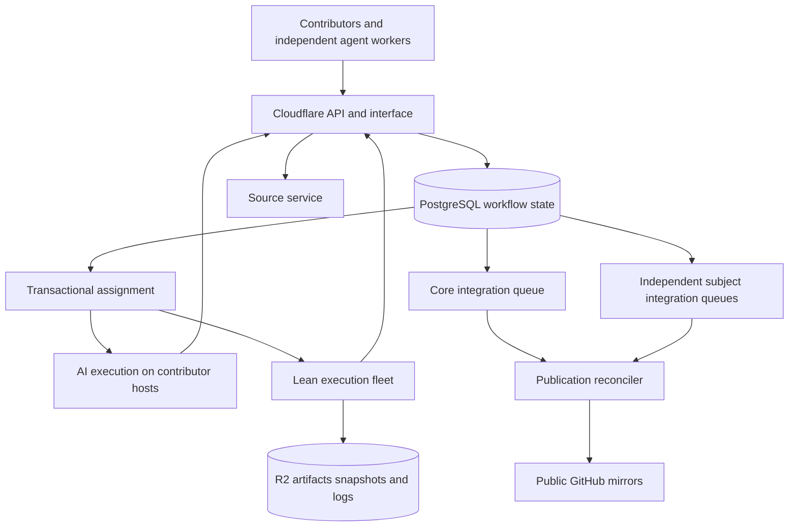
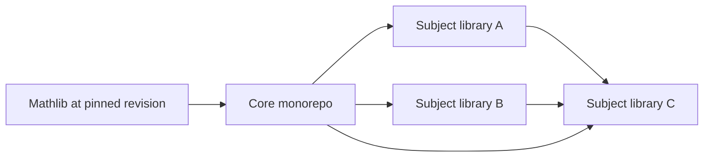

# Target Tau Ceti system

Tau Ceti will coordinate distributed contributors through a specialized service, preserve agents' judgments across revisions, and integrate a core monorepo plus downstream subject libraries through independent queues. The initial scale target is 100 landed contributions per hour at roughly 2,000 added Lean source lines each, totaling about 200,000 added lines per hour across libraries.

## Work preservation and mechanical correctness

During review before staging admission, the system trusts agents to judge mathematical and review continuity. An approval remains effective across ordinary edits, rebases, dependency changes, and migration unless an agent explicitly narrows or withdraws it, or a concrete finding blocks the relevant scope. There is no obligatory applicability review on every source change, timeout-based approval expiry, or automatic full review reset after an upstream advance.

Agents can accept repair work, reclassify a finding, preserve other reviewers' judgments, resolve contests, and request a targeted reassessment with a reason. Review provenance remains visible, including the originally examined revision. Carrying an approval forward does not pretend a fresh review occurred.

Mechanical evidence has a different contract. A successful build identifies the source snapshot, dependency vector, toolchain, checking policy, and executed targets. A different input cannot be relabeled as that successful build. Cache reuse and incremental checking establish evidence for new inputs through the build service. This distinction permits aggressive judgment reuse while preserving meaningful build results.

Expired attempts retain outputs. Fencing prevents an obsolete attempt from changing current mutable state; it does not discard the proof, review, diagnostics, or patch it produced. A reconciliation task can adopt useful work without repeating its inference.

## Architecture and authority

PostgreSQL owns workflow state and transitions. Git owns immutable source history. R2 holds referenced immutable payloads and artifacts. Queue deliveries and notifications announce work; they do not independently decide eligibility. The authoritative transition writes state, evidence references, and an outbox entry in one transaction.

The server exposes commands and scoped subscriptions. Workers receive assigned work and compact context rather than repeatedly scanning all contributions. Public readers use projections; decision-making reads use current transactional state.

The authoritative service is a deployment with recovery and backups, not necessarily one process or machine. Start with a regional PostgreSQL writer near the scheduling service, indexed independent transactions, and multiple stateless API instances. Do not serialize unrelated libraries through a repository-wide lock. Durable Objects may manage subscriptions or particular coordination units without duplicating database authority.

## Source and contribution model

A contribution has a permanent change ID, author and attribution, intent, target library, dependency requirements, immutable revisions, findings, approvals, and integration history. GitHub numbers become external identifiers. A revision can be a committed tree or a finalized snapshot of uncommitted work.

The source service supports normal Git workflows and direct snapshot submission. Server-owned immutable refs allow contributors to submit without creating a complete server-side fork. Mutable canonical refs can be advanced only by the designated integration publisher.

The initial native interface includes change diffs, history, findings, responses, review state, build diagnostics, queue position, dependency versions, and attribution. A contributor can use a CLI or ordinary Git plus the web interface. Public source, review records, stable links, and export preserve the openness of the present workflow.

GitHub login may be an optional identity provider. Claiming ordinary work or executing a review does not require a GitHub API request. Reviewer participation remains open under project policy. Enrollment and token scopes protect accounts and capabilities without requiring prior maintainer approval for every reviewer.

## Multiple libraries and dependency versions

The core is initially one integration unit containing a monorepo. Subject libraries normally have separate repositories, Lake package identities, namespaces, canonical refs, and queue policies. A registry separates library identity from repository location so later moves do not change contribution identity.

An integration unit is the smallest independently promotable source and policy boundary. Merely splitting files into Lake packages inside one repo and one branch does not create independently advancing queues. Libraries that share one canonical ref share a publication boundary, and may need a combined integration unit. Prefer separate subject repositories initially to make independence explicit.

Names here are illustrative. The registry resolves exact versions, not mutable branch names. A contribution and build use one dependency snapshot with exactly one revision per package identity. A diamond must resolve shared dependencies consistently, including Mathlib and Lean toolchain requirements. Resolution failures identify the incompatible paths instead of silently loading two conflicting copies.

The resolved package dependency graph must be acyclic. If proposed library boundaries require mutual imports, move shared definitions into an upstream package or integrate the mutually dependent material as one unit. Development coordination can be complicated without requiring a cyclic Lean package graph.

Each subject queue keeps using its pinned dependency snapshot while upstream queues advance. Dependency adoption is separate high-value work: select a newer compatible vector, build, repair, review relevant changes, then promote that vector for the subject. Coalesce repeated upstream notifications into one adoption job; do not restart adoption on every upstream commit. An agent can retarget an adoption attempt when the saved work makes that worthwhile.

Compatibility checks for downstream consumers run asynchronously with configurable priority. A library merge does not wait for every transitive consumer to finish adopting it. A published ecosystem manifest can identify a coherent vector for users who need several libraries together, without making ecosystem-wide validation a prerequisite for every local merge.

For a rare coordinated change, construct immutable commits for the affected libraries, validate their combined vector, and atomically publish one ecosystem-manifest pointer. Individual Git refs and GitHub mirrors can converge afterward. Atomicity belongs to that declared release view; the design does not promise a distributed transaction across Git repositories. Ordinary local queues remain independent.

Roadmap routing and soft overlap hints keep most subject contributions out of core. Agents can promote shared abstractions into core with downstream adaptation plans. Monitor the fraction of changes touching core, cross-library adoption cost, and joint-release frequency: many repositories will not reduce contention if almost every change still needs a shared core edit.

## Independent integration policies

The [standalone AI merge queue plan](specs/ai-merge-queue.md) is the implementation starting point for staging repair in the existing GitHub/CI workflow. Implement it as a separate Python queue service that takes over opted-in repositories from Bors. It can be delivered before the multi-library system described here.

Each integration unit chooses a versioned queue backend:

| Policy | Failure handling | Initial use |
| --- | --- | --- |
| `conventional` | Batch and split, retry infrastructure failures, return identified failures to ordinary contribution work | Libraries where traditional Bors behavior is effective |
| `ai_staging` | Scripts combine accepted contributions and control CI/publication; agents resolve conflicts and repair source failures | Libraries where acceptance transfers integration responsibility |

Normal policy changes apply to new work. When no inference path is available, AI staging holds with membership and retained source intact and resumes automatically; there is no conventional-splitting fallback.

AI staging retains accepted source and transfers integration responsibility to the queue. Scripts apply clean contributions and rebases, schedule/interpret CI, and fast-forward a passing head batch. Agents resolve conflicts and fix source-dependent failures, preserving constituent PR intent as best they can. Each batch remains a linear series with one squash commit per PR. Explanations are concise append-only commit-message additions, from which the publisher constructs modification comments. There is no separate staging-review phase or exceptional-withdrawal process. After staging admission, authors/reviewers address discovered problems through follow-up PRs to Tau Ceti while the queue lands the AI's best-effort integration.

AI staging maintains approved PRs waiting for insertion, one open batch receiving them, and one sealed head being rebased, built, repaired in place and fast-forwarded; the open batch seals when the head lands. There is no per-batch PR cap or membership eviction, no batch is stacked on an unlanded predecessor, the open batch runs no CI, and insertion draws at random within an age window of the oldest approved PRs. Claims fence every mutation. Successor batches with background CI, combination under a cap and cap-pressure sealing are later increments, adopted only when the first increment's measurements show the need. Only a sealed head based on current canonical source with passing CI can land. When no inference path is available the queue holds and resumes automatically.

AI staging distinguishes infrastructure failures, build failures, conflicts, reviewer findings, and unresolved integration obligations. Problems that require the operator become visible owned work with checkpoints. They do not trigger silent dropping, splitting, or a pretend green result. Reserve execution capacity for repair and operator intervention so new authoring cannot consume the entire fleet.

## Lean execution

The [build service](specs/lean-build-service.md) accepts immutable snapshots from workers and CI. It has interactive, candidate, staging, and dependency-adoption workloads. Agents submit incremental source updates and receive diagnostics without co-locating their sessions with heavy builds.

The implementation is greenfield. The [federated cluster contract](specs/build-cluster.md) makes capacity contributed by different owners a core requirement. A logical cluster can combine machines discovered/provisioned through an operator's SSH inventory, machines enrolled by collaborators with a token and one shell command, and managed pools such as Kubernetes. These share an execution protocol without sharing administration, a LAN, a filesystem, or a Kubernetes control plane. Direct nodes connect outbound; owners retain enforceable CPU, memory, disk, and availability limits.

Bootstrap discovers the machine instead of assuming Docker, Python, root, systemd, Lean, or a particular OS is already available. It installs the supported executor/runtime within granted permissions or reports the specific capability needed. Enrollment method, runtime isolation, and artifact trust remain separate. Managed pools are one execution backend; their orchestration API is not the build service's public API.

Warm workspaces and artifacts are keyed by toolchain, dependency identity, configuration, source, and requested checking policy. A whole-project pilot can reuse existing local verification and Mathlib cache machinery. Later measurements determine whether module-level remote execution is worth adding.

Memory admission is as important as CPU admission. Schedule measured resource classes, preserve warm locality without starving other libraries, and deduplicate equivalent verification requests. Multiple callers subscribe to one job. Cancelling one subscriber does not cancel work still needed by another.

Ordinary contributor execution stays isolated from publication credentials, artifact signing keys, and other attempts' writable state. Shared artifacts used as authoritative CI inputs must come from an accepted execution origin. Broadly trusting AI judgment does not grant candidate code the ability to impersonate the build service.

## Hosting and tools to reuse

| Area | Starting proposal | Reuse and evaluation |
| --- | --- | --- |
| API, public interface, auth entry | Cloudflare Workers | Existing deployment and observability conventions |
| Workflow records | Managed PostgreSQL, initially compatible with Neon operations | Existing state-service transactions, generation fencing, restore practices |
| Artifact and log storage | R2 with local SSD caches on executors | Existing Lake cache publication and immutable Mathlib snapshots |
| Notifications and delivery | Queues plus transactional outbox | Existing durable webhook handling and replay practices |
| Long-lived orchestration | Database state machine initially | Evaluate Cloudflare Workflows or Temporal where they eliminate real recovery code |
| Source and review interface | Conventional Git host plus native interface | Evaluate Gerrit; Forgejo can supply general hosting and UI |
| Lean execution | Federated owner-controlled machines and managed pools, with warm local storage | Greenfield executor protocol; lessons from Kiln and evaluation of Lake cache, Buildbarn, and Kimina mechanisms |

Cloudflare Queues provides at-least-once delivery, so consumers must be idempotent. Cloudflare Workflows offers durable steps, retries, and external-event waits. Temporal also expects retry-safe activities. Neither removes the need for application-level contribution, lease, and Git publication preconditions. [Queues](https://developers.cloudflare.com/queues/reference/delivery-guarantees/), [Workflows](https://developers.cloudflare.com/workflows/), [Temporal](https://docs.temporal.io/activity-definition)

The state service's current PostgreSQL deployment provides useful operational experience. Use a separate schema, roles, and resource limits for the new coordinator; extending the product must not couple its rollout to GitHub mirror availability. Hyperdrive is optional. If used, disable query caching for decisions because cached reads are not invalidated by writes. [State-service ownership](https://github.com/TauCetiProject/TauCetiTools/blob/3b24d80e0f6ec2028a1b5597a01d6555d4daec24/services/github-state/POSTGRES.md), [Hyperdrive semantics](https://developers.cloudflare.com/hyperdrive/concepts/query-caching/)

Cloudflare Containers' default largest size is currently 4 vCPU, 12 GiB memory, and 20 GB disk, with limit increases available by arrangement. Disks are ephemeral by default and snapshot support depends on scheduling policy. Benchmark selected Lean jobs before treating Containers as the primary build fleet. R2 is suitable for durable artifact distribution; its direct egress has no bandwidth charge, while storage and requests are billed. [Container limits](https://developers.cloudflare.com/containers/platform/limits/), [container storage](https://developers.cloudflare.com/containers/faq/), [R2 pricing](https://developers.cloudflare.com/r2/pricing/)

Gerrit provides persistent changes and patch sets; its review-copying and submit rules would require configuration consistent with permissive continuity. Buildbarn provides remote execution workers and artifact transport but needs a Lake adapter. Kimina provides parallel REPL checks, rather than whole-library CI. Modern Lake has remote artifact-cache operations; verify compatibility with the project's pinned version before implementation. [Gerrit](https://gerrit-review.googlesource.com/Documentation/concept-changes.html), [Buildbarn](https://github.com/buildbarn/bb-remote-execution), [Kimina](https://github.com/project-numina/kimina-lean-server), [Lake](https://github.com/leanprover/lean4/blob/master/src/lake/Lake/CLI/Help.lean)

Kiln is a source of lessons about diagnostics, source capture, cache preparation, materialized reuse, and recovery. The build service does not require its code, deployment model, private repository, or operator procedures. Choose execution and enrollment interfaces to serve independently owned hardware rather than inheriting one installation's cluster assumptions.

## Capacity and service objectives

The sustained target is 100 landed changes/hour, with a workload mix around 2,000 added Lean lines/change. That is 2,400 changes/day and 4.8 million added lines/day if maintained continuously. Lines count text, not mathematical value; report deletions, theorem/API progress, and sampled review quality alongside additions. Do not reward padding or forcing unrelated work into a size quota.

Track separately: opened, accepted, staged, landed, mirrored, abandoned, repaired, and reopened obligations. Count a contribution once even if its staging repair spans several commits. Report per-library and aggregate rates, accepted-to-landed latency, queue age, review reuse, duplicate inference, cache hit rate, and inference/build cost per landed change.

Build capacity follows measured CPU seconds and peak resident memory, not LOC alone. At 100 changes/hour, 30 CPU-minutes/check and three check equivalents/change imply 150 occupied cores, or about 215 provisioned cores at 70% utilization. This is an illustrative calculation, not a measured requirement. Full rebuilds and shared dependency changes need separate workload classes.

For inference, if each landed contribution consumes two agent-hours including unsuccessful work, 100/hour requires 200 active agent equivalents. Measure the actual distribution and provider quotas before funding that concurrency. At 2,000 lines/change, reviewer context, repair quality, and interactive latency need new measurements; small present-day PR timings cannot be extrapolated directly.

A queue lane integrating 20 changes in a 10-minute successful cohort has a theoretical ceiling of 120/hour before repair and idle time. This illustrates why more independent lanes and bounded repair time help; it does not establish the required cohort size or predict failure frequency.

Initial control-plane load objectives are specified in the component specs: 1,000 simultaneous worker sessions, 100 assignment commands/second, 10,000 outstanding jobs, and 100 build submissions/minute. These are benchmark targets with bounded payloads, not capacity already demonstrated. A later 10-times-target synthetic replay tests headroom without buying inference.

## Operations and migration

Deploy independent services live. Existing rounds and CI continue. Authority moves by explicit integration unit, change, or work key with a monotonically increasing epoch. Shadow services can observe freely; only the active owner performs conflicting mutations. Rollback transfers ownership without erasing evidence or resetting approvals.

The source service, database, and object store need export and restore procedures with checked reference integrity. Replicas and backups should include dependency manifests and source objects required to resume obligations. Active/active writers and cross-region consensus are unnecessary initial complexity; test regional recovery against an operator-selected recovery objective.

GitHub mirrors publish asynchronously with idempotent expected-parent updates and observable lag. A GitHub outage leaves internal queues available. Downstream package retrieval must use the internal source or artifact service so a GitHub outage does not re-enter through dependency downloads.

Open questions and deployment prerequisites are recorded in the [migration plan](migration-plan.md). The early services are useful even if the native interface or final Git hosting choice changes.
