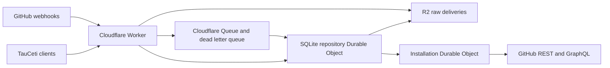

# Shared GitHub state

Reporting clients can use authenticated `POST /v1/activity` with
`{"repository":"TauCetiProject/TauCeti","numbers":[1,2]}` (maximum 500 numbers).
It returns stored PR headers, original observation timestamps and missing IDs.
This route is observation-only: no repository configuration, demand renewal,
repair jobs, upstream validation or installation-scheduler access. Closed PRs
without cached merge evidence have no landing timestamp. See
[activity reporting](../../docs/activity.md); reporting clients must retain stale
data or unknowns when unavailable, without direct GitHub fallback.

The Cloudflare service receives GitHub webhooks and serves repository state to
TauCeti clients. Production and test each use a separate private, read-only
GitHub App installation on `TauCetiProject/TauCeti`. The service owns those read
quotas. Authoring and commenting continue with the workers' existing credentials.



## Data and recovery

The Worker verifies the raw-body HMAC before durably writing a delivery to R2
and submitting its pointer to the queue. The repository object acknowledges
only after recording the event and repair jobs. Delivery IDs make replays
idempotent; timestamps and tombstones protect newer records from older events
and API responses. Large identifiers retain their decimal digits.

SQLite stores indexed resources, collection membership and coverage, repair
jobs with pagination state, a seven-day change journal, and stable query
snapshots. Initial inventories and histories publish complete coverage after
all pages finish. A failed page preserves the previous complete collection.
Snapshots paginate at 500 rows or approximately 1.49 MB per page; continuation
reads individual pages rather than repeatedly decoding the entire inventory.
Concurrent queries at the same revision share a snapshot.

PR and issue headers, commit statuses, check runs, workflow runs, and workflow
jobs update from webhook payloads. A changed PR does not start a full repository
survey. Full inventories reconcile hourly; overlapping deltas catch missed
updates. Workflow reconciliation starts with a one-hour window and then reads
the overlapping creation tail. It is a collection of observed recent runs,
not an exhaustive historical Actions index. Completed workflow jobs stop
polling and can update again through rerun webhooks.
Quiet closed PRs also stop periodic history and head polling once their
baseline is complete. Webhook updates continue, and renewed client demand
reactivates background reconciliation while returning the stored result.

Raw deliveries expire after fourteen days, daily snapshots after seven days,
staging pages after one day, and query cursors after ten minutes. R2 cursor
objects expire after a one-minute grace period. Active resource spill objects
remain readable while referenced by the SQL state.

The installation object owns token refresh, all GitHub read requests,
per-resource quotas, API selection, and accounting. Every GraphQL query asks
for `rateLimit.cost`; concurrent header differences are not point accounting.
REST 304 responses record zero primary points. Similar quota pressure permits
selection by measured latency; scarce pools are preserved for operations with
no alternative API. Batch histories and reactions reduce request cost. Nested
or outer overflow continues through the normal paginated reader.

Primary exhaustion defers that pool and tries a compatible alternative.
REST-exhausted flat review histories promote the existing GraphQL thread
reconciler, which supplies the same flat collection without duplicating a
reader. REST-capable batches can also move to REST before GraphQL exhaustion
when their measured cost/headroom makes that pool preferable.
Secondary limits pause both pools after the actual rejection and honor
`Retry-After`. HTTP-200 GraphQL quota errors are also recognized. Known data
remains available while background reads wait. New content, concurrency,
compute, point, or primary quota categories appear in protected health telemetry
and structured logs. There is no preemptive pacing of GitHub writes.
Exhaustion midway through pagination restarts the staged read in a compatible
pool; it never mixes REST pagination URLs with GraphQL cursors or publishes a
partial collection. Token renewal respects its own exhausted quota too.

Background scheduling uses requested-gap, active-change, verification, and
archival lanes, weighted 8:4:2:1 with unused shares borrowed by eligible work.
Missing requested coverage is promoted immediately without revoking actual
quota cooldowns or pagination. Old numeric priorities cannot keep historical
CI ahead of worker-needed histories. Each alarm launches up to sixteen
requests in four-request waves during a ten-second launch window. Network
calls run outside installation-wide locks; atomic quota reservations and
expiring job leases protect concurrent requests. Large nested thread histories
checkpoint one comment page per quantum instead of monopolizing a turn.

`RECONCILIATION_SETTINGS` is an optional JSON variable with `concurrency`
(default/max 4), `dispatches` (default 16, max 100), `launch_ms` (default 10000,
max 30000), and four positive `weights` (default `[8,4,2,1]`). Settings affect
background reads only. Health includes lane eligibility, oldest requested age,
repair arrivals/completions/cancellations, wait reasons, requested latency p95,
and measured cost/latency by query shape and batch size.

Workflow/job webhooks retain observed records without compulsory full-list
backfills. Complete enumeration is requested on demand, or for important runs
on `staging` and `trying`: every minute while active and once after completion.
Completed undemanded repair jobs retire without deleting their records. Run
attempts have separate current membership; old attempts remain retained and
cannot pollute reruns. `workflow_runs` remains an observed recent-run inventory.

## Client behavior

Clients request the newest available service data, including conditional reads.
They do not impose an age threshold or validate with GitHub before spending.
Unavailable coverage, invalid client credentials, or failed transport uses the
existing direct facade. A shared circuit breaker bounds repeated outage probes.
Healthy pagination can exceed the initial five-second outage interval; each
request and stalled interval remains bounded. Partial histories never become
empty results. The direct facade and service share the field/route catalog in
`tauceti_worker/github_catalog.json`.

Worker surveys use a materialized, roadmap-filtered fact snapshot instead of
fetching every PR's full comment histories. The scheduling cascade remains in
the worker for full service-outage fallback. See [compact surveys](../../docs/compact-surveys.md)
for scope rules, per-history coverage, migration, telemetry, and cross-language
contract tests.

```toml
max_open_prs = 128
github_state_url = "https://github-state.taucetiproject.org"
github_state_token_file = "/home/kim/.config/tauceti-github-state/client-token"
```

The cutoff defaults to eight and must be a positive integer. Read-policy
configuration changes wait for an idle round boundary; they must not interrupt
paid sessions. Direct quota failures retain publication intents privately,
including copied body files, so replay does not repeat paid authoring. Ambiguous
creates reconcile with GitHub before replay; opaque ambiguous mutations remain
pending rather than being blindly duplicated.

Shared host snapshots of TauCetiRoadmap refresh hourly and review references
every fifteen minutes. These are immutable, self-contained read-only checkouts
with leases for active users. A fetch failure can reuse the existing snapshot.

## Operator commands

Registration forms already contain the organization, webhook URL, read
permissions, and subscriptions. Register production and test separately:

- https://github-state.taucetiproject.org/setup/register
- https://github-state-test.taucetiproject.org/setup/register

Exchange the one-use manifest code on stdin. Credentials stay under the private
`~/.config/tauceti-github-state[-test]` directory. Node converts GitHub's RSA key
to PKCS8 when system OpenSSL is unavailable. `finish-exchange` can recover from
a conversion failure without consuming another registration code.

```sh
python3 services/github-state/scripts/setup.py inspect --environment test
python3 services/github-state/scripts/setup.py deploy --environment test
python3 services/github-state/scripts/setup.py bootstrap --environment test
```

`inspect` discovers the installation and checks its permissions and selected
repository using App authentication. Deployment provisions resources
idempotently and uploads secrets without printing them. Wrangler keeps remote
variables, so later code deployments preserve the App and allowlist settings.

```sh
cd services/github-state
npm ci
npm test
npm run deploy -- --env test
npm run deploy -- --env ''
```

`POST /v1/activity` also derives Lean LOC from complete cached PR file lists,
checking immutable file URLs against the PR's head/base and header totals.
Derived counts are cached by PR head/base and file-collection revision, with at
most 32 uncached computations per request. It reads stored resources only: no
client demand, upstream request, repair job, or closed-PR polling is created.

`/healthz` is public and exposes only service identity/version. `/v1/health`,
`/v1/query`, `/v1/query_batch`, and `/v1/changes` require a repository-scoped
client token. Valid credentials querying an unavailable repository scope get
a structured `status:unavailable` response with no data, so that scope cannot
poison outage handling for supported repositories. Invalid credentials still
return 401. `/admin/bootstrap` requires the separate admin credential.
Installation tokens and private keys never reach clients.

`workflow_jobs` queries may explicitly request `allow_observed=true` (top-level
JSON boolean for query batches). The response declares `coverage` as
`webhook_observed` and `complete:false` when an exhaustive list is unavailable.
Unknown runs remain unavailable. Other operations reject this option. Existing
clients still require complete coverage; Python `read_workflow_jobs(...,
allow_observed=True)` returns metadata with the rows rather than implying that
the observed list is exhaustive.

The test environment enables `/admin/reference`: a protected, uncached
catalog-only read through its installation quota owner. It requires the admin
token and `REFERENCE_READS=true`; production disables it by default. Reference
reads share test accounting and quota reservations, and never repair the test
mirror before comparing it. No arbitrary API paths or queries are proxied. Catalog-generated measurement
batches (up to 100 aliases and twenty initial review threads) use this same
owner, returning only cost/latency/overflow summaries. `measure.py` no longer
mints an independent installation token or spends quota outside that owner.


## Measurements and rollout

`scripts/measure.py` uses the same query builders as production, with the test
installation by default. It records explicit charges, latency, response size,
and overflow without retaining response bodies or credentials. The October 12
samples found: 100 issue histories = 1 point; ten PRs with ten initial review
threads = 1 point, versus 2 points with twenty threads; 25 status or reaction
reads = 1 point, and increasing status/reaction batches to 100 still costs one
point. The hundred-item batches measured 2.3–2.5 seconds for histories,
1.3–1.4 seconds for statuses, and 0.79–0.82 seconds for reactions. Smaller
thread pages caused continuation overhead in the sample, so the default uses
ten initial threads and twenty comments.

```sh
python3 services/github-state/scripts/measure.py --environment test
python3 services/github-state/scripts/shadow.py --once
python3 scripts/github-state-capacity.py --run-rate 1500
```

The shadow sampler rotates through active and quiet PRs, comments, threads,
reactions, statuses, checks, and workflow runs/jobs every five minutes. Hourly
independent inventories detect PRs absent from both mirrors. Reference requests
are uncached reads through the test quota owner, bounded to sixteen requests
per sampling turn with private continuation checkpoints. Inventories and long
histories continue across turns; incomplete samples do not imply agreement.
Sample logs contain fingerprints/discrepancy categories rather than comment
bodies, and track observed convergence. Observations stay local; routine fleet
reports remain every four hours and shadow checks never gate model spending.
Client
rollout progresses through one, three, and nine existing science workers,
without changing the controller's worker schedule or accrued grants.
The local `tauceti-github-state-rollout.timer` applies that progression after
one hour of initial mirror observation and at least twelve comparison rounds,
with one hour after each canary stage actually reloads. Promotions also require
a recent successful independent comparison, both mirrors available, and no
differences in that latest sample. These checks hold promotions; existing
clients continue working with the service and its direct-API fallback.
`scripts/rollout.py --apply --observation-hours 2 --stage-hours 2` can select
longer windows without resetting accrued observation time. The default is one
hour for each window. It preserves disabled workers and operator overrides.
Creating `~/.local/state/tauceti/github-state-shadow/rollout-paused` suspends
future promotions. Inspect progress with `scripts/rollout.py`; no new worker
or funding operation is part of that script.

The local 5,000-PR fixture verifies pagination, concurrent snapshot reuse, and
coherence across later events. Its mocked upstream latency is not evidence of
Cloudflare network throughput. The capacity model separates baseline evidence,
design assumptions, and reaction-density stress scenarios. Bootstrap/recovery
bursts, native CLI queries without point instrumentation, and GitHub write
secondary limits remain explicit coverage limitations.
See [the capacity evidence and tradeoffs](../../docs/github-state-capacity.md)
for the assumptions behind the $1,500/hour workload projections.


For reconciliation upgrades, observe the test deployment for one hour, then
observe the compatible production deployment for one hour. Existing nine
clients need no configuration changes or restarts. Save deployment versions
and before/after health; roll back code if coverage or lease correctness fails,
without resetting SQL/R2 state, worker schedules, or funding. Historical
archival backlog need not reach zero. Single-page requested-gap completion
should stay below sixty seconds when quota has headroom; multi-page repairs
and actual quota waits are reported separately.

`observe_reconciliation.py --environment test --version <deployment-id>`
records a one-hour health window after both objects report that exact
Cloudflare deployment. Run it again for production after promotion. Evidence
is private under `~/.local/state/tauceti/github-state-reconciliation`; it does
not send notifications or alter worker configuration. A quota-deferred request
is distinguished from a repair stalled with available quota.
Use `--resume` after a process or host interruption. Saved samples are retained,
but gaps longer than twice the sampling interval do not count toward the hour.

## Publication recovery and quota pauses

An actual GitHub quota rejection becomes a `waiting-github` pause with a reset
or retry time. It does not advance the no-progress backoff or consume a PR's
retry allowance. Opaque CLI commands may use an available API pool; the proxy
waits on the pool a request actually exhausts. Mirror-backed stages are not
parked by an unrelated exhausted search or direct-read quota.

Retained publications are replayed after a definitive rejection, or reconciled
before replay after an uncertain acknowledgement. Unresolved publications
hold their own PR target while unrelated work continues. Temporary bodies and
stdin input remain in the private intent. Local recovery controls are:

```sh
uv run python -m tauceti_worker.github_outbox list
uv run python -m tauceti_worker.github_outbox abandon --intent <private-path> --note <reason>
uv run python -m tauceti_worker.github_outbox retry --intent <private-path> --note <reason> --acknowledge-duplicate-risk
```

Manual retry only releases an intent for the normal recovery path; it does not
send a GitHub request immediately. An ambiguous write may already have landed.
Issue creation and review replies reconcile against retained bodies and authors;
acknowledgement matching allows five minutes of clock skew. Unknown mutation
types retain their evidence for operator recovery. Retained duplicate commands
honor the recovery deadline instead of repeatedly retrying every five seconds.
Claims and post-write progress acknowledgements use direct reads to avoid
webhook delivery races; ordinary surveys continue using the freshest service
data, with no age gate before spending.

Native cost checkpoints are provisional while the process remains alive. If
termination interrupts the final receipt, the ledger keeps the checkpoint as
a provisional reservation, covering the known lower bound plus another full
session estimate. Funded peers can continue; the affected provider session
still needs a final receipt or explicit reconciliation. These reservations
are estimates, not hard upper bounds on provider spending. Final receipts with
missing cost segments remain unresolved, reserving any known lower bound plus
an estimated tail. Missing evidence retains the original admission reservation.
They hold only their own provider resumption; other funded work can proceed.
Provisional costs are excluded from settled expenditure and reported separately. Existing grants and settled ledger events are preserved.

Endpoint accounting consumes multiline `gh` debug bodies privately and records
measured GraphQL cost and operation type, without exporting request bodies.
Missing staging pages restart their collection; persistent parser and transport
errors retain pagination and retry with exponential delays from one minute to
one hour. Webhook redelivery auth and transport failures remain retryable while
other gaps proceed; deleted deliveries trigger one broad repair and are skipped.

The existing cron separately caches Bors promotion receipts from its public,
read-only candidate journal through the `BORS_ACTIVITY` HTTP service binding,
at most once per five minutes for TauCeti. The production and test environments
both read the existing production Bors journal; the request is fixed to GET on
the candidate observation endpoint, with no public-network fallback. This
never calls GitHub, registers demand or changes merge authority. Receipts bind
the original approved PR head to the constructed commit and recorded promotion
to main. `/v1/activity` reads this cache only, allowing squash-merged PRs to count
as landed even when GitHub describes them as closed. Failed journal reads retain
last-known receipts and expose the current preparation error.

Daily R2 archives use version-2 manifests and bounded, resumable table pages.
They record the starting and ending revisions and are observational archives;
Durable Object point-in-time recovery remains the database backup. Unreferenced
R2 spill objects can be collected eight days after retirement, leaving seven-day archive
references and active SQL references intact. SQLite resource rows are retained;
long-term database growth still needs a cold-storage policy before claiming
sustained operation at the modeled $1,500/hour scale.
